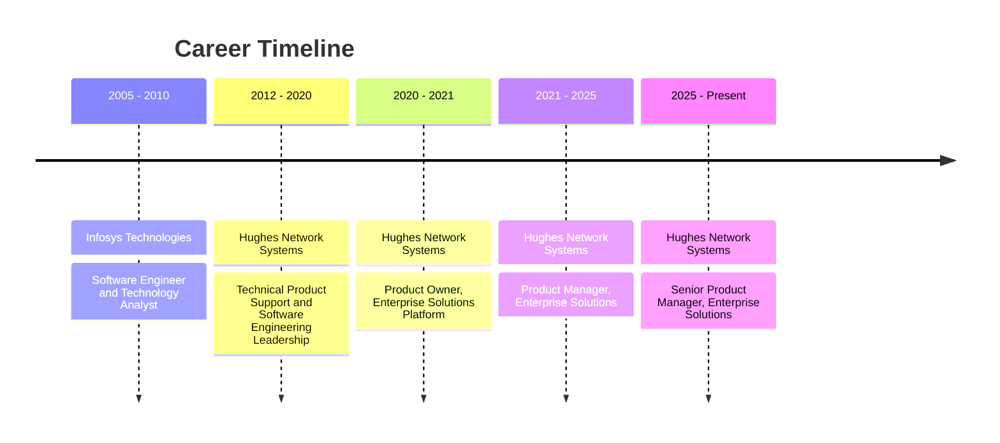

# Arun Kumar Ramaswamy

### Senior Product Manager | Product Strategy & Execution

I build enterprise products that solve real customer problems and hold up at scale.

 

| 🏢 **18** | 🤝 **75+** | ✅ **98%** |
|:---:|:---:|:---:|
| Years in enterprise tech | Fortune 500 customers served | On-time launch delivery |

---

## 👋 About Me

I have spent 18 years in enterprise technology, 14 of them at Hughes Network Systems, an EchoStar company. For the last six I have owned products and delivery programs for the North America Enterprise business.

I run roadmaps, prioritization, and releases for enterprise SaaS and multi-tenant platforms used by Fortune 500 customers. Each year I review 150+ feature requests across six releases, and I govern 7 strategic initiatives across 8 business units, managing dependencies, risks, and release cadence.

I turn complex technical and business requirements into scalable products, and I lead cross-functional engineering, design, and operations teams. I own the customer journey for the Hughes Managed LEO (Low Earth Orbit) service and the private wireless network program, from ideation through rollout, including ordering, installation, support, and repairs.

### 🎯 Roles I am targeting

- Senior product leadership roles
- Senior program management and technical program management roles
- Senior engagement management roles

### 💬 What colleagues say I am good at

- Bridging business strategy and technical execution
- Turning ambiguous business needs into clear BRDs and PRDs that reduce rework
- Coordinating competing priorities across teams, even with limited resources
- Explaining technical trade-offs to executives in business terms
- Staying with a product from intake through launch

---

## 📊 Impact at a Glance

| | Result | What it came from |
|---|---|---|
| 🚀 | **98%** on-time delivery across 10+ program launches | Enterprise Working Committee, 6 releases a year |
| 🧭 | **7 initiatives, 8 business units** | Strategic portfolio governance |
| 📥 | **150+** feature requests reviewed each year | Data-driven scoring and ROI justification |
| 🔧 | **80%** lower customer installation cost | Self-install offering, about $500+ saved per truck-roll |
| 🤖 | **40%** less manual effort | RAG-based AI ordering agent |
| 📝 | **30%** less manual triage time, **20%** more productivity | Copilot-driven intake workflow |
| 🐞 | **25%** fewer post-launch defects | Design reviews with dev leads before each release |
| ⏱️ | Order clarification cut from **3 to 4 days to hours** | Automated order intake |

---

## 🛠️ Selected Work

### 📡 Hughes Managed LEO Service
Led the service from concept to customer launch. I own the full customer journey: ordering, installation, self-service, RMAs, repairs, and usage reporting. I coordinated engineering and logistics teams to enable a multi-channel distribution model.

### 🔌 Self-Install Capability
Brought it to market in 5 months. It cut customer installation costs by 80% and expanded the addressable market.

### 📶 Private Wireless Network Program
Architected the business system strategy and delivered integrated ordering, installation, logistics, and maintenance workflows while keeping operations running.

### 🤖 AI Ordering Agent
Launched an ordering agent with a RAG-based contract intelligence engine for eligibility checks and API-driven order placement. Manual effort dropped 40%.

### 🧠 Copilot-Driven Intake Workflow
The workflow ingests requirements documentation, synthesizes use cases, and flags cross-team dependencies. It also automates technical documentation and status reporting.

### 🏗️ Multi-Vendor Customer Systems Platform
Facilitated architecture and design discussions with security, networking, and virtualization SMEs. I sequenced provisioning, monitoring, and support workflows through design reviews and dependency mapping across 10+ service lines with zero disruption.

### 📈 More
- **AI-powered executive dashboard** that gives leadership real-time customer visibility
- **Customer portal and extended warranty program** with API integrations for ticketing, order status, and asset tracking
- **Automated order intake** built after analyzing time-to-install metrics and business KPIs

---

## 💼 Experience

<b>Senior Product Manager, Enterprise Solutions & Multi-Tenant Services</b> | Hughes Network Systems | 03/2025 to Present

 

**Scope and governance**
- I lead end-to-end product management for enterprise SaaS and hardware platforms supporting 75+ Fortune 500 customers across North America.
- I oversee 7 strategic initiatives across 8 business units, with 100% on-time delivery over the first 9 months.
- I chair the cross-functional prioritization committee that manages 150+ feature requests and enhancement priorities a year across 6 releases, using data-driven scoring and ROI justification.

**Customer-facing launches**
- Led the Hughes Managed LEO service from concept to customer launch. I own the full customer journey (ordering, installation, self-service, RMAs, repairs, usage reporting) and coordinated engineering and logistics teams to enable a multi-channel distribution model.
- Brought a self-install capability to market in 5 months. It reduced customer installation costs by 80% (about $500+ saved per truck-roll) and expanded the addressable market.
- Architected the business system strategy for the private wireless network program and delivered integrated ordering, installation, logistics, and maintenance workflows.
- Built a customer-facing portal with API integrations for ticketing and order-status visibility, plus an extended warranty program with API-based asset tracking and automated cost-reduction workflows.

**Architecture**
- Facilitated architecture and design discussions with security, networking, and virtualization SMEs to design a multi-vendor customer systems platform.
- Led design reviews and dependency mapping that sequenced provisioning, monitoring, and support workflows across 10+ service lines with zero disruption.

**AI and automation**
- Launched an AI ordering agent with a RAG-based contract intelligence engine for eligibility checks and API-driven order placement. Manual effort fell 40%.
- Delivered a Gen AI and Copilot-driven intake workflow that ingests requirements documentation, synthesizes use cases, flags cross-team dependencies, and automates technical documentation and status reporting. Manual triage time fell 30% and productivity rose 20%.
- Own an AI-powered executive dashboard that gives leadership real-time customer visibility.

*Internal title: Sr. Principal Data Analyst*

<b>Product Manager, Enterprise Solutions & Multi-Tenant Services</b> | Hughes Network Systems | 06/2021 to 03/2025

 

- Managed the Enterprise Working Committee, covering requirements definition, backlog prioritization, and delivery for 6 annual software releases of 20 to 25 features and enhancements each.
- Coordinated planning and go-to-market execution for 10+ product launches and feature releases across order-to-cash and operational systems, with 98% on-time delivery.
- Ran customer discovery sessions with enterprise stakeholders and turned their pain points into use cases, roadmaps, and business requirements documents.
- Defined CRM and ERP business system requirements for a strategic enterprise program and rolled out integrated ticketing and RMA systems.
- Reviewed technical designs with development leads before each release and caught gaps against customer requirements. Post-launch defects fell 25%.
- Analyzed time-to-install metrics and business KPIs, then implemented automated order intake. Order clarification dropped from 3 to 4 days to hours, which sped up customer onboarding.

*Internal title: Principal Data Analyst-II*

<b>Product Owner, Enterprise Solutions Platform</b> | Hughes Network Systems | 06/2020 to 06/2021

 

- Partnered with enterprise business users to define, prioritize, and deliver requirements and enhancement requests.
- Reviewed designs and test plans with development teams to confirm feature quality and customer alignment before production rollout.

*Internal title: Principal Data Analyst-I*

<b>Technical Product Support & Software Engineering Leadership</b> | Hughes Network Systems | 03/2012 to 06/2020

 

- Provided technical escalation support for enterprise customers.
- Led end-to-end platform migrations, including root-cause analysis, post-migration validation, and requirements gathering.
- Defined and ran product qualification testing across order management, provisioning, and CRM applications before release.
- Advanced through four technical leadership roles: Software Engineer (MTS Level 2/3), Senior Member of Technical Staff, and Principal Engineer-1.

<b>Software Engineer & Technology Analyst</b> | Infosys Technologies | 09/2005 to 06/2010

 

- Led requirements analysis, design, development, and support for client IT systems and interfaces across four roles in five years.
- Supported enterprise system migrations and the development of new interfaces.
- Received the Technical Excellence and STAR Awards for technical competency and project delivery.

---

## 🧰 Skills & Tools

| Area | What I work with |
|---|---|
| 🎯 **Product Strategy** | Roadmap ownership, OKR/KPI governance, GTM planning, portfolio management, RICE, MoSCoW, WSJF, PRD/BRD development |
| 🤖 **Gen AI & LLM Delivery** | RAG-based decision support, agentic workflow design, Copilot-driven requirements and status reporting, LLM documentation synthesis |
| 📋 **Program Management** | SAFe and PI Planning, PMO process design, Agile/Scrum, RAID logs, cross-org governance, release cadence |
| 🛡️ **Risk & Quality** | Release readiness reviews, UAT coordination, SLA and defect management, process automation, change management |
| 🗣️ **Executive Communication** | QBRs, executive dashboards and reporting, roadmap presentations, C-level stakeholder partnership |
| 🏗️ **Architecture Leadership** | Technical design reviews, working with engineering SMEs, influencing without authority, chairing governance committees |
| 🌐 **Enterprise Platforms** | Multi-tenant and BSS/OSS architecture, CRM and ticketing, RMA, warranty and asset tracking, order-to-cash, multi-vendor integration |

**Tools**

Also: Smartsheet, SOAP UI, Informatica Cloud, Lovable.

---

## 🎓 Certifications & Education

### Certifications

| | Credential | Issued | Credential ID |
|---|---|---|---|
| ☁️ | Google Cloud Certified Generative AI Leader | Oct 2026 | [81610](https://www.credly.com/badges/ba411bfd-7338-4fff-93a2-752d8f64d7d8/public_url) |
| 🟠 | AWS Certified AI Practitioner | Sep 2026 | [c464aa22ddcf4263a8b581fe379d9907](https://www.credly.com/badges/acef5035-65ba-485a-b49d-aac34f8e87f2/public_url) |
| ☁️ | Google Cloud Certified Cloud Digital Leader | Sep 2026 | [123839](https://www.credly.com/badges/8f24f563-9de8-4da4-a8d2-a6b23ef1bd2e/public_url) |
| 🧭 | Certified Scrum AI for Product Owner | Aug 2026 | [View credential](https://bcert.me/vvozbmwar) |
| 🧭 | Certified Scrum Product Owner (Scrum Alliance) | Aug 2026 | [001840610](https://bcert.me/vyhvglqxc) |
| 🔵 | IBM AI Aware Graduate | Dec 2025 | |
| 📘 | PMP Exam Prep Boot Camp | Sep 2025 | |
| ⚡ | Salesforce Certified Force.com Developer | Feb 2015 | 2338476 |

### Education

- 🎓 **Post Graduate Program in Artificial Intelligence for Leaders**, The University of Texas at Austin, McCombs School of Business (May 2025, GPA 4.17)
- 🎓 **M.S. in Telecommunications**, University of Maryland, College Park (2012, GPA 3.45 / 4.0)
- 🎓 **B.E. in Electronics and Communication**, Anna University, Chennai (2005, GPA 3.80 / 4.0, Gold Medal for graduating 2nd in class)

### 🧪 AI & Data Program Projects (Great Learning, UT Austin program)

| Project | What I did | Methods |
|---|---|---|
| **NlpNomics** | Predicted whether news articles are relevant to US economics | NLP, classification, supervised learning |
| **AllLife Bank** | Segmented customers by spending patterns and interactions | K-means, EDA |
| **Extraa Learn** | Predicted whether a sales lead converts to a paying customer | Neural networks, decision trees, ensembles |
| **OTT View Counts** | Wrote an AI problem statement and POC, then predicted first-day views | Linear regression, KNIME |

---

## 🏆 Awards

- **Excellence Award in Solution Delivery**, Hughes Network Systems (2021, 2022, 2025)
- **Real-Time Recognition Awards**, Hughes Network Systems, for mission-critical solutions and high-impact projects
- **Technical Excellence and STAR Awards**, Infosys Technologies

---

## 🗣️ Recommendations

All 32 of my LinkedIn recommendations, in full, newest first. Click a name to expand.

<b>Dan Rasmussen</b> | SVP & General Manager, Enterprise Division, Hughes Network Systems | Jul 27, 2026

> Arun was instrumental in supporting the software development activities for my business units. I watched him progress from a key individual contributor to accomplished team leader. Arun has a strong technical understanding of the software development process and the requirement to integrate technical capabilities into business reality. I appreciate Arun's ability to serve as the central person coordinating competing priorities between several cross functional teams. He consistently found solutions to continue advancing solutions in a very constrained environment that did not provide his team the resources to accomplish all the goals. I am confident that Arun will continue to excel and make a significant contribution wherever his career takes him.

<b>Frank Kelly</b> | Vice President, Chief Technology Officer, Enterprise Services, Hughes Network Systems | Apr 15, 2026

> Arun is a very thorough and process-oriented engineer who takes a system perspective for business systems solutions. I would highly recommend him for a position related to business system governance, process requirements, and implementation and requirements oversight. He is a very team-oriented engineer who does great getting the various teams to communicate and work together to bring about business process improvement.

<b>Sindhu Rajan</b> | Vice President Global Service Delivery, Comcast Business | Feb 12, 2025

> I have had the pleasure of working with Arun since 2019 on multiple strategic projects. Arun has an excellent command of business processes and is easily ability to work with the IT teams to create effective and efficient systems. Arun has tremendous ability to tackle complex problems and create elegant solutions that often result in cost savings. Arun works extremely well with various business users and can adapt to changing requirements and help prioritize key and critical initiatives by aligning them with strategic goals. Because of his expertise Arun is often sought as the primary in major large projects. His contribution in creating the foundational business system architecture and processes for Hughes Managed LEO service and Aero mobility are some such key initiatives. His leadership style, attention to detail, innovative solutions make him an excellent asset to any team and organization.

<b>Bill Mounce</b> | Vice President, North American Division, Hughes | Aug 3, 2026

> As a standout Product Owner / Technical Program Manager, Arun consistently excelled at bridging business strategy and technical execution, acting as the critical link that turned complex operational needs into successful enterprise-scale outcomes. Arun owned the full requirements lifecycle, expertly managing intake, review, and prioritization of demanding business requirements across multiple enterprise sectors. He had a rare talent for translating business use cases into scalable technical system architectures and authoring clear, detailed BRDs that gave engineering and development teams precise, actionable guidance. His documentation and roadmap ownership were instrumental in steering our enterprise business systems toward the highest-priority strategic initiatives defined by management. Beyond his strong delivery skills, Arun stood out for his proactive stakeholder collaboration. He worked directly with executive and cross-functional leaders to deeply understand pain points and drive effective solutions. Arun combines high-level roadmap vision with rigorous technical execution discipline, and he is an outstanding collaborative communicator and sharp problem solver who makes every team better. I recommend Arun without hesitation for any Product Owner, TPM, or technical strategy role. He is the type of professional who delivers real impact and is a true asset to any organization.

<b>Eric Ashbaugh</b> | Vice President Enterprise Solutions Delivery, Hughes | Jul 27, 2026

> I highly recommend Arun for any senior leadership, business architecture, or product management role. Arun worked reporting to me for five years in our NAD Business System Governance team, where he consistently delivered exceptional results across complex enterprise initiatives. During his tenure, Arun mastered the critical bridge between business strategy and technical execution. His core strengths and impact include: Requirement Lifecycle Management: Managed the intake, review, and prioritization of complex business requirements across all enterprise sectors. Solution Architecture: Designed robust system architectures by translating intricate business use cases into scalable technical blueprints. Stakeholder Collaboration: Worked directly with executive and cross-functional stakeholders to deeply understand and solve their operational pain points. Technical Translation: Authored highly detailed Business Requirements Documents (BRDs) that provided clear, actionable guidance to engineering teams. Strategic Oversight: Controlled the enterprise business system feature roadmap and steered the solutions for our highest-priority strategic initiatives. Arun is a rare professional who possesses both the high-level vision to manage an enterprise roadmap and the technical discipline to oversee execution. He is a collaborative communicator, a sharp problem solver, and an asset to any organization. I would gladly hire him again.

<b>Bill Rumancik</b> | Sr. Director, Enterprise Product Management, Sales Operations, Hughes | Aug 26, 2026

> I had the opportunity to work closely with Arun Kumar Ramaswamy at Hughes as a peer and cross-functional partner, and I came to value his ability to bring structure, clarity, and technical discipline to complex business requirements. Arun is particularly strong at capturing and documenting detailed requirements, including the development of Business Requirements Documents (BRDs) and Product Requirements Documents (PRDs). What sets him apart, however, is his ability to take those requirements beyond documentation and help translate them into practical products, processes, and enhancements that deliver meaningful business value. He brings deep knowledge of BSS and order-to-cash workflows, including environments that span multiple vendor systems, automation platforms, and managed service offerings supporting distributed enterprise customers. That breadth of experience enables Arun to understand not only the immediate requirement, but also the broader operational, technical, and downstream business implications of a proposed change. In our work together, Arun was a strong partner to Product, Engineering, and other technical organizations. He contributed effectively to feature design reviews, UAT coordination, release planning, and the intake, review, and prioritization of demanding business requirements across multiple enterprise sectors. He has a strong ability to balance competing needs while maintaining focus on solutions that are scalable, viable, and supportable. One of the qualities I most respect about Arun is his sense of ownership. He is thoughtful and candid in his approach, and he stays engaged throughout the full lifecycle-from initial intake and requirements definition through design, testing, implementation, and release. I would highly recommend Arun for roles requiring strong technical acumen, BSS and process expertise, requirements management, and cross-functional product execution. He is a dependable and knowledgeable partner who understands how to connect business needs with practical, scalable solutions.

<b>Ajit Kumar Chalasani</b> | Vice President of Global Network Technologies, Solutions and Infrastructure, Hughes | Jul 29, 2026

> I had the pleasure of working with Arun in the Enterprise Solutions organization, where he consistently demonstrated the unique ability to bridge business strategy with technical execution. As a Solution Architect, he excelled at partnering with business stakeholders to deeply understand their objectives and operational challenges, translating those conversations into clear, actionable requirements for development teams. His ability to connect business needs with scalable technical solutions ensured that projects delivered real business value while remaining aligned with long-term architectural goals. Beyond requirements gathering, he played a pivotal role in shaping and overseeing the enterprise business systems roadmap, ensuring that feature development supported both immediate customer needs and broader strategic initiatives. His strategic thinking, combined with his deep understanding of enterprise systems, allowed him to prioritize initiatives that delivered measurable impact across the organization. One of his greatest strengths is his ability to bring together cross-functional teams. Whether working with business leaders, product owners, architects, or developers, he communicates with clarity, builds consensus, and keeps everyone focused on delivering successful outcomes. He has a natural ability to simplify complex problems and guide teams toward practical, scalable solutions. I would highly recommend Arun to any organization seeking a strategic Solution Architect or technology leader who can effectively align business vision with technology execution while driving enterprise transformation and innovation.

<b>Royce Hernandez</b> | Vice President of Mobility LEO Products and Services, Hughes Network Systems | Jul 30, 2026

> Arun consistently did excellent work for me at Hughes. He played a critical role in understand requirements from the business groups, and translating that into actionable steps for our various business process and software development teams. He understands the order to cash process, and how to organizationally identify workflows across departments to help business move forward successfully and efficiently.

<b>Mridul Malayanil</b> | Vice President, Enterprise Platforms & AI, Hughes | Jul 29, 2026

> I have had the pleasure of working with Arun for many years at Hughes Network Systems and have seen him grow from a Product Qualification Test Engineer into a Senior Principal Data Analyst, effectively serving as a Product Manager and Solution Architect. His career progression reflects his ability to combine technical expertise with a deep understanding of business processes and product delivery. Arun has made significant contributions to several strategic Hughes initiatives, including the Hughes Managed LEO launch, Retail Petroleum Self-Install, eSIM launch, Network Hub, Unified Portal, Private Wireless, and the initial Aero launch. Across these programs, he has led and supported end-to-end business process design, RMA, installation, spare pool management, and cross-functional solution delivery. One of Arun's greatest strengths is his ability to bridge business and technology. He works effectively with stakeholders to define requirements, translate them into scalable solutions, prioritize work with engineering teams, and drive execution through delivery. His expertise across OSS/BSS systems and service lifecycle processes enables him to understand both the strategic objectives and operational realities of complex programs. Arun is collaborative, dependable, and highly analytical. He communicates clearly, builds strong relationships across business and technical teams, and consistently demonstrates ownership and accountability. His calm approach to problem-solving and ability to manage competing priorities make him a trusted leader on complex initiatives. I highly recommend Arun for Product Owner, Product Manager, Program Manager, or Solution Management roles. He brings an exceptional combination of business acumen, technical depth, and delivery leadership, along with a proven ability to execute complex programs and deliver meaningful business outcomes.

<b>Karl Fosburg</b> | Senior Solutions Architect, Network/Systems/Services/Observability/Incident Management, Hughes | Aug 10, 2026

> I had the pleasure of working with Arun for 10+ years at Hughes. Arun is an excellent PM and has a strong ability to interpret business requirements and turn them into products, processes and enhancements to the business. His strong technical background allows him to work hand-in-hand with engineering, operations, and customer service to make requests realistic and deliverable. Arun is very professional and an excellent communicator. He would be a great addition to any organization.

<b>Sampath Tirumalai</b> | Sr. Director, Data Science, Hughes Network Systems | Aug 6, 2026

> I had the pleasure of working closely with Arun Kumar Ramaswamy, and I can confidently say he possesses a rare, highly valuable skill set: the ability to seamlessly bridge the gap between high-level business strategy and technical execution. In an organization where complex initiatives often get lost in translation, Arun consistently turned ambitious business goals into concrete, scalable engineering outcomes. What sets Arun apart is his end-to-end ownership of the product and requirements lifecycle. He managed the intake, review, and prioritization of complex requirements across all enterprise sectors, ensuring competing priorities stayed on track without a single detail dropping. Beyond simply collecting requirements, Arun acted as a true solution architect, taking ambiguous, high complexity use cases and shaping them into clear, scalable technical blueprints that our engineering teams could build against directly. Business Requirements Documents (BRDs) and Product Requirements Documents (PRDs) is usually top-tier. By authoring detailed, actionable specifications, Arun dramatically reduced ambiguity and rework during implementation phases. Equally impressive is his approach to stakeholder collaboration. He partnered closely with executive and cross-functional leaders, digging deep to uncover the root operational pain points beneath surface-level requests. Whether managing an enterprise-wide feature roadmap or driving execution on the organization's highest-priority strategic initiatives, he paired visionary planning with disciplined, hands-on execution. Arun excels in cross-functional environments, building strong collaborative relationships across engineering, product, design, and business teams to keep projects aligned and moving forward smoothly Above all, Arun is a collaborative communicator and a sharp, reliable problem solver. Any team looking for a strategic leader who can navigate both executive conversations and technical architecture would be fortunate to have them. I highly recommend Arun for any senior product, technical solution, or strategic execution role.

<b>Effie Torshizi</b> | Director, Enterprise Solutions, Hughes | Aug 2, 2026

> I had the pleasure of working closely with Arun for several years, during which we partnered on numerous cross-functional initiatives. Arun is a highly talented professional who combines strong technical expertise with a strategic product mindset. I have seen firsthand his ability to translate business needs into scalable solutions, define clear and actionable requirements, and drive complex initiatives from concept to delivery. He excels at collaborating with executives and cross-functional teams to solve operational challenges while balancing big-picture vision with technical execution. Beyond his technical expertise, Arun is a thoughtful teammate who is always willing to share knowledge, challenge assumptions constructively, and help others succeed. He is a collaborative leader, a sharp problem solver, and a trusted partner who consistently brings people together to achieve common goals. His strong communication skills, strategic mindset, and ability to influence across organizations enable him to drive meaningful outcomes and deliver results. I would highly recommend Arun to any organization seeking a professional who can effectively connect business vision, customer needs, and technical execution while fostering collaboration and innovation.

<b>Raymond Van Meter</b> | Director, Enterprise Field Services, Business Operations, Hughes Network Systems, LLC | Jul 31, 2026

> I worked with Arun at Hughes, and he's one of those people who makes hard programs look manageable. His grasp of BSS/OSS is genuinely deep, not the kind of knowledge you fake in a meeting, and it means he can go toe-to-toe with engineering on design details while still translating everything back into terms the business side understands. He was always the one writing the requirements that actually held up once development started, clear enough that nobody was guessing three sprints in. He'd stay close to the design work too, making sure what got built actually matched what end users needed, not just what was easiest to ship. That follow-through is rarer than it should be. He was also comfortable in front of the executive team, which matters more than people give it credit for. A lot of good PMs can manage a backlog but freeze up when they have to defend a roadmap to leadership. Arun never had that problem. Every project he touched came out better for having him on it, and the team was always glad to have him. If you're looking for someone who can own a product end to end, from requirements through delivery through the exec update, Arun is that person. He's also one of the most genuinely nice people I've ever met. Happy to speak with anyone considering him.

<b>Larry Hackett</b> | Manager, Business Systems Support and QA Team, Hughes | Jul 30, 2026

> Arun was a great teammate who worked diligently with all teams to solve challenging, complex problems. Arun is a detail-oriented person who always takes the time to research and investigate the causes of challenges in business processes before proposing solutions. His attention to detail helped avoid future operational challenges. Arun would be a great asset to any team.

<b>Diana Cole</b> | Director, Enterprise Service Delivery, Hughes Network Systems | Jul 30, 2026

> I had the pleasure of working with Arun on several launch projects, and I was consistently impressed by his ability to connect business needs with practical technical solutions. He takes the time to fully understand the business objective, then translates it into clear, actionable technical requirements that help teams move forward with confidence. Arun brings patience, persistence, and diligence to every engagement, and his commitment to delivering sound, viable business solutions is a major reason he is so well respected. Any organization would be fortunate to have Arun on its team, and I highly recommend him.

<b>Pranav Singh</b> | Sr. Director, Software Delivery, EchoStar Corporation (Hughes Network Systems) | Jul 30, 2026

> I worked with Arun Kumar Ramaswamy at Hughes, and he's equally at home working with technology leaders and deep in the engineering weeds. He'd partner with execs to unpack the objectives and operational problems, then help the team translate them into solutions, writing very clear BRDs/PRDs. He has a very good understanding of business processes. Arun helped create the enterprise solutions, and had a keen instinct for proposing sound architecture and design. He's very collaborative. Any team looking for a Product Manager, TPM, or Director who can hold the big picture while still getting into the details would benefit greatly from his contributions.

<b>Dorothy Gordon</b> | Director, Program Management, Atlantic Region, Hughes | Jul 30, 2026

> I had the pleasure of partnering with Arun as an internal customer, and he was one of the most valuable resources I worked with. He consistently took the time to understand our business objectives, operational challenges, and customer needs before translating them into thoughtful, scalable technical solutions. Arun had an exceptional ability to bridge the gap between business and technology. He asked the right questions, challenged assumptions when appropriate, and ensured requirements were clearly defined so engineering teams could execute with confidence. His product insight and technical expertise helped us navigate complex initiatives while keeping the focus on delivering meaningful business outcomes. What I appreciated most was Arun's collaborative approach. He was always approachable, responsive, and genuinely invested in helping our team succeed. Even during high-pressure initiatives and incredibly tight deadlines, he remained calm, solution oriented, and committed to finding the best path forward. His ability to explain complex technical concepts in a way that business stakeholders could easily understand made him an invaluable partner. I would highly recommend Arun for any Product Management, Technical Program Management, or Director level role. Any organization would benefit from his strategic mindset, technical depth, and unwavering commitment to his customers and teammates.

<b>Abhishek Nayak</b> | Sr. Product Manager, Hughes | Jul 30, 2026

> I had the privilege of working closely with Arun while launching critical managed services at Hughes. He was consistently dependable, with exceptional attention to detail, and played a key role in helping our product team launch new services that enabled us to enter new verticals. Arun operates at the intersection of business strategy and technical execution. He owned end-to-end requirement lifecycle management, turned ambiguous use cases into scalable technical blueprints, and authored clear, detailed BRDs/PRDs that reduced rework for engineering. He collaborated directly with executives and cross-functional stakeholders to shape solutions around real operational needs, while steering our highest-priority strategic initiatives on the enterprise roadmap. What sets Arun apart is his rare dual capability: enterprise-level roadmap vision combined with hands-on technical discipline. He's a collaborative communicator and sharp problem solver, and he would be an asset to any company. Any organization would be lucky to have him on their team.

<b>Sonia Thakur</b> | Sr. SysDev Engineer, Amazon Leo | Jul 29, 2026

> I had the opportunity to work closely with Arun on cross-functional initiatives spanning requirements, solution planning, and process optimization. Arun has an exceptional ability to turn complex data and stakeholder inputs into clear priorities and actionable solutions. His strategic mindset, collaborative leadership, and focus on outcomes make him a trusted partner for both business and engineering teams. I would highly recommend Arun to any organization seeking a leader who consistently delivers practical solutions with measurable impact.

<b>Aziza Alachbili</b> | Head of In-Flight Connectivity, Royal Air Maroc | Oct 23, 2025

> I've had the privilege of working with Arun, and he stands out for his rare ability to turn complex business requirements into clear, actionable technical roadmaps. He navigates intricate decision paths with remarkable clarity, designing processes that align vision and execution seamlessly. His analytical depth is matched by a rare talent for structuring processes that bring clarity, alignment, and measurable results.

<b>William Charles Kruger</b> | Sr Director of Program Management, Northern Region, Hughes | Nov 13, 2024

> Arun Kumar Ramaswamy is a skilled and insightful professional, equally effective in hands-on roles or leading a team. One of his standout strengths is his ability to translate user requirements into clear, actionable technical specifications. He listens carefully, avoiding imposing his own vision unless it aligns with user needs, ensuring collaborative, user-focused outcomes. Arun is also adept at prioritizing requirements in sync with project timelines and release dates. He brings a problem-solving mindset, often thinking outside the box to develop innovative solutions. Arun recently supports the AERO In-Flight initiative with requirements, design, and business system architecture. Previously he supported Enterprise Accounts as an SME. I highly recommend and endorse him for his expertise and professionalism.

<b>Banu Rekha Kathalingam</b> | Vice President of Products, Turbo Federal, LLC | Feb 8, 2022

> I have known Arun both professionally and Personally for over 5 years now and have had opportunities to work in close proximity in many projects. Arun is a self motivated, reliable Team Member who goes above and beyond to push project towards success. His attention to details, clear documentations and deep dives into business and technical systems have made him the subject matter expert in his projects. He is the recipient of many accolades from all his stakeholders and is a great addition to any Team. His constant quench for knowledge and willingness to run at great speed keeps him on top of the game. He takes sincere efforts to teach/mentor his juniors and attempts to attain perfection in all his deliverables. His patience and calm and composed nature makes him one of the most likeable personality. His interest towards photography makes him see the beauty in everything and comes out as a pleasant person. I wish Arun the best in his career and recommend him to all future interest! I have known him as a peer and as a manager and can proudly attest that he is a great addition to any Team.

<b>Danielle Collier-Nechikh</b> | Principal Technical Program Manager, Global Customer Support Operations, Twilio | Feb 8, 2022

> In the three to four short years that I've had the honor of working with Arun, I can say with absolute certainty that he is a an exceptional team member. He approaches every challenge with a positive and methodical attitude that allows him to truly understand the business requirements prior to making any implementations or recommendations on the strategy to move forward. Arun is very well respected due to his constant support of his peers and willingness to think outside of the box to allow the business to succeed by all means. Arun is an expert in his field and is constantly evolving his skill set to better serve the needs of the organization. I can't even count how many times I've been in a pinch and Arun has saved the day. Arun is a strong leader that has the ability to bring people together seamlessly. I cannot recommend Arun highly enough. He is invaluable and such an incredible asset.

<b>Mridul Malayanil</b> | Vice President, Enterprise Platforms & AI, Hughes | Aug 23, 2021

> It would amaze one to see how detail oriented Arun is. Anything he touches or does is upto the perfection and leaves no ambiguity. Very jovial person to work with, Arun has a knack of learning fast and grasping the technical details very quickly. He is a joy to work with.

<b>Vineet Gupta</b> | Director, Engagement Delivery, Salesforce | May 22, 2021

> I know Arun as Technical Process Owner in B2B Program from the business side where I was responsible for delivering B2B Sales and Marketing Capabilities at Hughes. He is extremely detail oriented and does lot of hard work in defining the problem statement to make a valid business use case. He is on top of every business process and know how systems talk to each other in and out. Along with that, Arun also has strong written and communication skills and I really believe that he will be successful in any organization.

<b>Tom Tran</b> | Sr. Director Engineering, NextNav | Jul 18, 2012

> Arun is a diligent professional who delivers high-quality work and on-time as expected. He also has a broad grasp of technical knowledge and is a pleasure to work with.

<b>Kamran Etemad</b> | Senior Technology Advisor, FCC | May 17, 2012

> Arun showed good decipline and quality work as a graduate student in my class on Advanced Wireless Communications. He was in the top 10% of my class and I expect him to be a an effective contributer and team player in work environment as well.

<b>Tor Wallin Andreassen</b> | Founder and Leader, TWAConsult.no | Apr 29, 2012

> I had the pleasure of having Arun in my Marketing Telecommunication class as part of a joint program between the Engineering school and the Business school at University of Maryland, while I was a Visiting Professor there Spring 2012. Arun was always prepared, very polite and considerate to other students. His comments or questions reflected a good understanding and a clarity in articulating the problem. Consequently he helped us all to a better understanding. With Arun's work diciplin and work ethics, he will be a valuable asset to any firm who will be fortunate to have him as an employee.

<b>Giles Davies</b> | PM, SAP Projects, Carestream Health | Feb 11, 2011

> I have known Arun Kumar as a member of Infosys team at Rochester, NY. He worked in one of our projects from November 2008 till June 2009. He was a dedicated, reliable, member of our team. He was responsible for doing technical and functional analysis of our manufacturing system in mainframes. He has a strong analytical and technical skills which helped him to analyze our manufacturing system in mainframes. His ability to analyze our manufacturing system in detail helped him in drafting a detailed system documents. He is very detail oriented and analyzes a problem from all possible scenarios to arrive at an efficient solution. In conclusion, I would highly recommend Arun Kumar for his contribution in my project. His Analytical, technical, leadership skills will always be a positive asset to all future employer.

<b>Karthik Padmanabhan</b> | Product Creator, Self-employed | Oct 13, 2010

> I have known Arun since the Kodak days in Infosys. He is sincere and hardworking. He appears cool and calm but at the back of his mind he sets ambitious goals for himself and he achieves those target with swift. He is an excellent team player and will be an asset to any of the organization. All the best Arun for a bright future !!!

<b>Shivakumar Shankaran</b> | Vice President of Strategic Sales, Jade Global | Sep 18, 2010

> At work, I've known Arun for a period of 3 months only as we worked together in a migration project for an international Imaging organization. But this 3 months was quite enough for me to get amazed by the abilities this kid (i know he is no more a kid...:)) possess. I've seen a say NO attitude in him always and he was the best amongst our team mates in steering the project ship to shore. There were quite a few challenges in the project as the migration server was completely, kind of a black box for us and more than anyone, Arun took lead to find a treasure from the black box and resolved many more issues while the migration was happening. I would say, Arun naturally comes in with a whole bunch of abilities: good in analytical, soft skills, tech, hard working, and the list goes on. Arun, I wish you all best to happen in your life. You always show an excellent attitude and make people around you look more positive than ever. You are a POSITIVE ENERGY.

<b>Bhaskar Babu</b> | Managing Director, Accenture | Sep 15, 2010

> Arun is a self starting driven individual. He worked in my team for over 2 years. He is very good technically and innovative at work. I wish him the best in his career.

Also available on [LinkedIn](https://linkedin.com/in/arunkumar116).

---

## 📫 Let's Connect

I am open to senior product, program, and engagement management roles.

