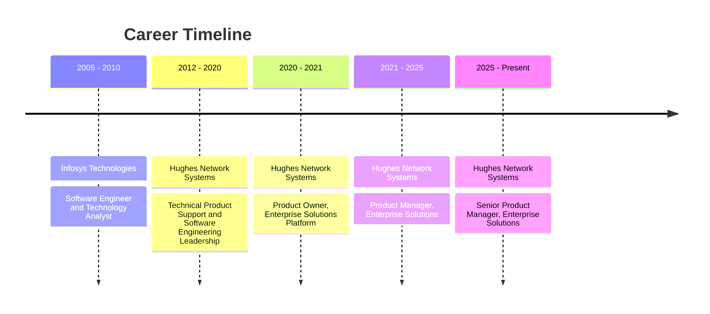

# Arun Kumar Ramaswamy

### Senior Product Manager | Product Strategy & Execution

I build enterprise products that solve real customer problems and hold up at scale.

 

| 🏢 **18** | 🤝 **75+** | ✅ **98%** |
|:---:|:---:|:---:|
| Years in enterprise tech | Fortune 500 customers served | On-time launch delivery |

---

## 👋 About Me

I have spent 18 years in enterprise technology, 14 of them at Hughes Network Systems, an EchoStar company. For the last six I have owned products and delivery programs for the North America Enterprise business.

I run roadmaps, prioritization, and releases for enterprise SaaS and multi-tenant platforms used by Fortune 500 customers. Each year I review 150+ feature requests across six releases, and I govern 7 strategic initiatives across 8 business units, managing dependencies, risks, and release cadence.

I turn complex technical and business requirements into scalable products, and I lead cross-functional engineering, design, and operations teams. I own the customer journey for the Hughes Managed LEO (Low Earth Orbit) service and the private wireless network program, from ideation through rollout, including ordering, installation, support, and repairs.

### 🎯 Roles I am targeting

- Senior product leadership roles
- Senior program management and technical program management roles
- Senior engagement management roles

### 💬 What colleagues say I am good at

- Bridging business strategy and technical execution
- Turning ambiguous business needs into clear BRDs and PRDs that reduce rework
- Coordinating competing priorities across teams, even with limited resources
- Explaining technical trade-offs to executives in business terms
- Staying with a product from intake through launch

---

## 📊 Impact at a Glance

| | Result | What it came from |
|---|---|---|
| 🚀 | **98%** on-time delivery across 10+ program launches | Enterprise Working Committee, 6 releases a year |
| 🧭 | **7 initiatives, 8 business units** | Strategic portfolio governance |
| 📥 | **150+** feature requests reviewed each year | Data-driven scoring and ROI justification |
| 🔧 | **80%** lower customer installation cost | Self-install offering, about $500+ saved per truck-roll |
| 🤖 | **40%** less manual effort | RAG-based AI ordering agent |
| 📝 | **30%** less manual triage time, **20%** more productivity | Copilot-driven intake workflow |
| 🐞 | **25%** fewer post-launch defects | Design reviews with dev leads before each release |
| ⏱️ | Order clarification cut from **3 to 4 days to hours** | Automated order intake |

---

## 🛠️ Selected Work

### 📡 Hughes Managed LEO Service
Led the service from concept to customer launch. I own the full customer journey: ordering, installation, self-service, RMAs, repairs, and usage reporting. I coordinated engineering and logistics teams to enable a multi-channel distribution model.

### 🔌 Self-Install Capability
Brought it to market in 5 months. It cut customer installation costs by 80% and expanded the addressable market.

### 📶 Private Wireless Network Program
Architected the business system strategy and delivered integrated ordering, installation, logistics, and maintenance workflows while keeping operations running.

### 🤖 AI Ordering Agent
Launched an ordering agent with a RAG-based contract intelligence engine for eligibility checks and API-driven order placement. Manual effort dropped 40%.

### 🧠 Copilot-Driven Intake Workflow
The workflow ingests requirements documentation, synthesizes use cases, and flags cross-team dependencies. It also automates technical documentation and status reporting.

### 🏗️ Multi-Vendor Customer Systems Platform
Facilitated architecture and design discussions with security, networking, and virtualization SMEs. I sequenced provisioning, monitoring, and support workflows through design reviews and dependency mapping across 10+ service lines with zero disruption.

### 📈 More
- **AI-powered executive dashboard** that gives leadership real-time customer visibility
- **Customer portal and extended warranty program** with API integrations for ticketing, order status, and asset tracking
- **Automated order intake** built after analyzing time-to-install metrics and business KPIs

---

## 💼 Experience

<b>Senior Product Manager, Enterprise Solutions & Multi-Tenant Services</b> | Hughes Network Systems | 03/2025 to Present

 

- Lead product management for enterprise SaaS and hardware platforms supporting 75+ Fortune 500 customers across North America
- Oversee 7 strategic initiatives across 8 business units, with 100% on-time delivery in the first 9 months
- Chair the cross-functional prioritization committee for 150+ annual feature requests across 6 releases a year
- Led the Managed LEO launch, the private wireless program, the self-install offering, and the AI ordering and intake tools described above

*Internal title: Sr. Principal Data Analyst*

<b>Product Manager, Enterprise Solutions & Multi-Tenant Services</b> | Hughes Network Systems | 06/2021 to 03/2025

 

- Managed the Enterprise Working Committee for 6 annual releases of 20 to 25 features each
- Coordinated planning and go-to-market for 10+ launches across order-to-cash and operational systems, with 98% on-time delivery
- Ran customer discovery sessions and turned pain points into use cases, roadmaps, and business requirements documents
- Defined CRM and ERP requirements for a strategic enterprise program and rolled out integrated ticketing and RMA systems

*Internal title: Principal Data Analyst-II*

<b>Product Owner, Enterprise Solutions Platform</b> | Hughes Network Systems | 06/2020 to 06/2021

 

- Worked with enterprise business users to define, prioritize, and deliver requirements and enhancements
- Reviewed designs and test plans with development teams before production rollout

*Internal title: Principal Data Analyst-I*

<b>Technical Product Support & Software Engineering Leadership</b> | Hughes Network Systems | 03/2012 to 06/2020

 

- Handled technical escalations for enterprise customers and led end-to-end platform migrations, including root-cause analysis and post-migration validation
- Defined and ran product qualification testing across order management, provisioning, and CRM applications
- Moved through four technical leadership roles, from Software Engineer to Principal Engineer

<b>Software Engineer & Technology Analyst</b> | Infosys Technologies | 09/2005 to 06/2010

 

- Led requirements analysis, design, development, and support for client IT systems and interfaces across four roles in five years
- Supported enterprise system migrations and new interface development
- Received Technical Excellence and STAR Awards

---

## 🧰 Skills & Tools

| Area | What I work with |
|---|---|
| 🎯 **Product Strategy** | Roadmap ownership, OKR/KPI governance, GTM planning, portfolio management, RICE, MoSCoW, WSJF, PRD/BRD development |
| 🤖 **Gen AI & LLM Delivery** | RAG-based decision support, agentic workflow design, Copilot-driven requirements and status reporting, LLM documentation synthesis |
| 📋 **Program Management** | SAFe and PI Planning, PMO process design, Agile/Scrum, RAID logs, cross-org governance, release cadence |
| 🛡️ **Risk & Quality** | Release readiness reviews, UAT coordination, SLA and defect management, process automation, change management |
| 🗣️ **Executive Communication** | QBRs, executive dashboards and reporting, roadmap presentations, C-level stakeholder partnership |
| 🏗️ **Architecture Leadership** | Technical design reviews, working with engineering SMEs, influencing without authority, chairing governance committees |
| 🌐 **Enterprise Platforms** | Multi-tenant and BSS/OSS architecture, CRM and ticketing, RMA, warranty and asset tracking, order-to-cash, multi-vendor integration |

**Tools**

Also: Smartsheet, SOAP UI, Informatica Cloud, Lovable.

---

## 🎓 Certifications & Education

### Certifications

| | Credential | Issued | Credential ID |
|---|---|---|---|
| ☁️ | Google Cloud Certified Generative AI Leader | Oct 2026 | [81610](https://www.credly.com/badges/ba411bfd-7338-4fff-93a2-752d8f64d7d8/public_url) |
| 🟠 | AWS Certified AI Practitioner | Sep 2026 | [c464aa22ddcf4263a8b581fe379d9907](https://www.credly.com/badges/acef5035-65ba-485a-b49d-aac34f8e87f2/public_url) |
| ☁️ | Google Cloud Certified Cloud Digital Leader | Sep 2026 | [123839](https://www.credly.com/badges/8f24f563-9de8-4da4-a8d2-a6b23ef1bd2e/public_url) |
| 🧭 | Certified Scrum AI for Product Owner | Aug 2026 | [View credential](https://bcert.me/vvozbmwar) |
| 🧭 | Certified Scrum Product Owner (Scrum Alliance) | Aug 2026 | [001840610](https://bcert.me/vyhvglqxc) |
| 🔵 | IBM AI Aware Graduate | Dec 2025 | |
| 📘 | PMP Exam Prep Boot Camp | Sep 2025 | |
| ⚡ | Salesforce Certified Force.com Developer | Feb 2015 | 2338476 |

### Education

- 🎓 **Post Graduate Program in Artificial Intelligence for Leaders**, The University of Texas at Austin, McCombs School of Business (May 2025, GPA 4.17)
- 🎓 **M.S. in Telecommunications**, University of Maryland, College Park (2012, GPA 3.45 / 4.0)
- 🎓 **B.E. in Electronics and Communication**, Anna University, Chennai (2005, GPA 3.80 / 4.0, Gold Medal for graduating 2nd in class)

### 🧪 AI & Data Program Projects (Great Learning, UT Austin program)

| Project | What I did | Methods |
|---|---|---|
| **NlpNomics** | Predicted whether news articles are relevant to US economics | NLP, classification, supervised learning |
| **AllLife Bank** | Segmented customers by spending patterns and interactions | K-means, EDA |
| **Extraa Learn** | Predicted whether a sales lead converts to a paying customer | Neural networks, decision trees, ensembles |
| **OTT View Counts** | Wrote an AI problem statement and POC, then predicted first-day views | Linear regression, KNIME |

---

## 🏆 Awards

- **Excellence Award in Solution Delivery**, Hughes Network Systems (2021, 2022, 2025)
- **Real-Time Recognition Awards**, Hughes Network Systems, for mission-critical solutions and high-impact projects
- **Technical Excellence and STAR Awards**, Infosys Technologies

---

## 🗣️ Recommendations

I have 32 recommendations on LinkedIn from executives, peers, and partners. A few excerpts:

> "He had a rare talent for translating business use cases into scalable technical system architectures."
>
> **Bill Mounce**, VP, North American Division, Hughes

> "He's also one of the most genuinely nice people I've ever met."
>
> **Raymond Van Meter**, Director, Enterprise Field Services, Hughes

[Read all of them on LinkedIn](https://linkedin.com/in/arunkumar116)

---

## 📫 Let's Connect

I am open to senior product, program, and engagement management roles.

